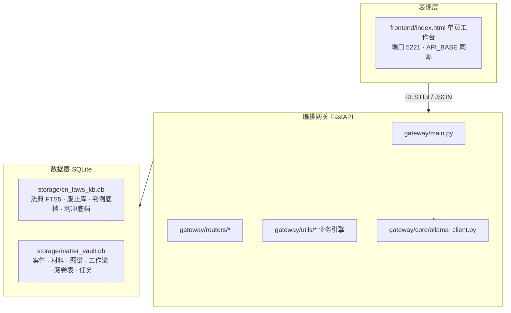

# LawFlow 智律工作台 —— 系统架构（与代码现状对齐）

> 面向中国执业律师的本地优先办案提效系统。产品名：**LawFlow** / **智律工作台**。  
> 网关与前端统一监听 **127.0.0.1:5221**。

---

## 一、整体结构



路径由 `gateway/core/paths.py` 集中解析，可通过环境变量覆盖：

| 变量 | 默认 |
| :--- | :--- |
| `LAWFLOW_STORAGE_DIR` | `<仓库根>/storage` |
| `LAWFLOW_FRONTEND_DIR` | `<仓库根>/frontend` |
| `LAWFLOW_TEMPLATES_DIR` | `<仓库根>/templates` |
| `LAWFLOW_FONTS_DIR` | `<仓库根>/fonts` |

---

## 二、检索与大模型（现状）

### 法条 / 类案检索

- **实现方式**：SQLite **FTS5 关键词匹配**（及条号精确查询、子母法关联表），**不是**向量 RAG。
- **外部向量库 / RAGFlow**：**规划中，未使用**。compose 中不再默认挂载相关网络。

### 大模型 Provider（`LLM_PROVIDER`）

| 值 | 行为 |
| :--- | :--- |
| `auto`（默认） | 若配置了可用的云端 API Key，则走云端；否则使用本地 Ollama |
| `cloud` | 强制云端（如 DeepSeek，由 `LLM_BASE_URL` / `LLM_CLOUD_MODEL` 指定） |
| `ollama` | 强制本地 Ollama（`OLLAMA_BASE_URL` + `LLM_MODEL`） |
| `rule_engine` | 专家规则路径，尽量不调用大模型 |

**云端外发前脱敏**：对请求文本做身份证号、银行卡号等 PII 扫描与替换（见 `/api/v1/settings/pii/scan` 与客户端侧脱敏逻辑）。办案原文仍可能经脱敏后发往云端；若需完全离线，请使用 `ollama` 或 `rule_engine`，并勿配置云端密钥。

---

## 三、端口与可选容器

| 服务 | 编排 | 宿主机端口 | 说明 |
| :--- | :--- | :--- | :--- |
| LawFlow Gateway + Web | 默认 | **5221** | FastAPI + 静态前端 |
| Stirling-PDF | 默认（compose） | 8081 | PDF 中间件（可选） |
| DocuSeal | profile `phase3` | 8082 | 电子签；未配置时网关走**演示**签署 |
| Docassemble | profile `planned` | 8080 | **规划中，当前代码未使用** |
| RAGFlow | — | — | **规划中，未使用** |
| 宿主机 Ollama | 系统服务 | 11434 | 本地大模型 |

本地开发推荐：

```bash
python -m uvicorn gateway.main:app --host 127.0.0.1 --port 5221
```

---

## 四、主要业务模块（与路由对应）

- 阶段一精算与立案文书：例如 `/api/v1/phase1/calc/rmb-capital`、`/api/v1/phase1/generate-litigation-package`
- 证据与合同审查：例如 `/api/v1/phase2/auto-catalog`、`/api/v1/phase2/contract-review`
- 类案关键词检索与电子签：例如 `/api/v1/phase3/rag/search`、`/api/v1/phase3/create-signing-link`（检索为 FTS/关键词，非向量）
- 要件推演与执行穿透：例如 `/api/v1/deep-matrix/analyze`、`/api/v1/enforcement/penetration-audit`
- 法典库：例如 `/api/v1/statutes/overview`、`/api/v1/statutes/search`
- 利冲与引用熔断：例如 `/api/v1/conflict/check`、`/api/v1/guard/audit-citations`
- 案件空间与阅卷：例如 `/api/v1/vault/matters`
- 设置与 PII：例如 `/api/v1/settings/llm`、`/api/v1/settings/pii/scan`

健康检查：`GET /health` 返回 `{"status":"healthy","app":"LawFlow"}`。

---

## 五、安全要点

1. 默认绑定 `127.0.0.1`；通过 `LAWFLOW_API_TOKEN` + `X-LawFlow-Token` 保护 `/api/*`。
2. 诉讼费、LPR、劳动补偿等金额由确定性 Python 算法计算，不依赖大模型算术。
3. Citation Guard 对废止法规与未核验案号做拦截；法条库收录范围有限，需律师核验标记。
