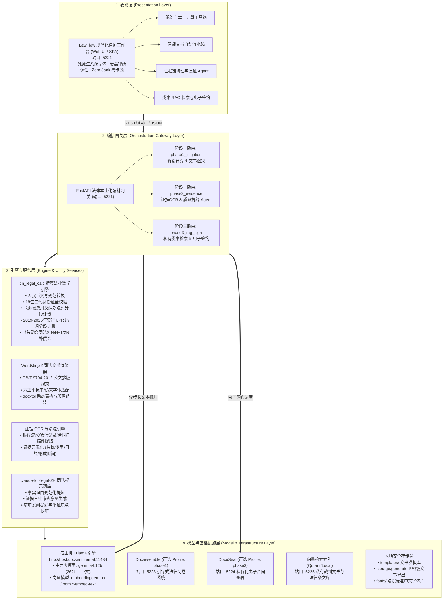
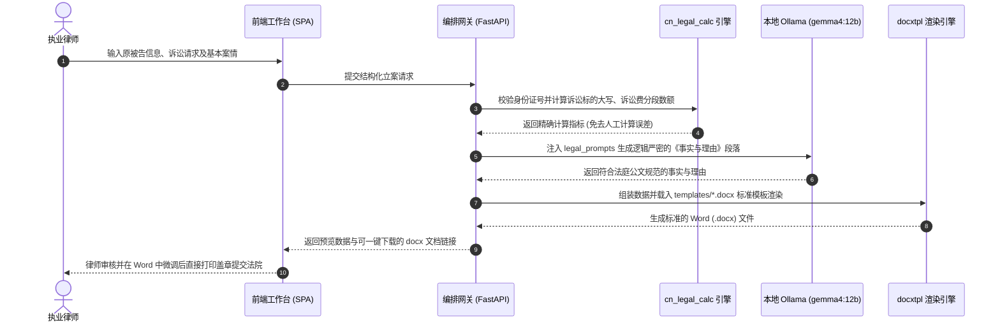
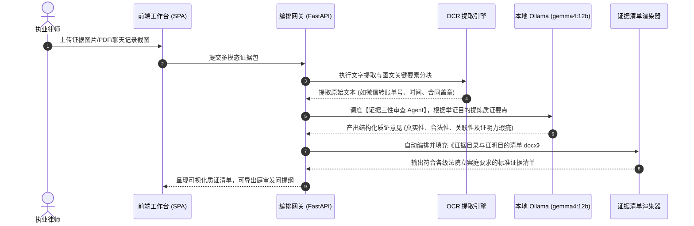
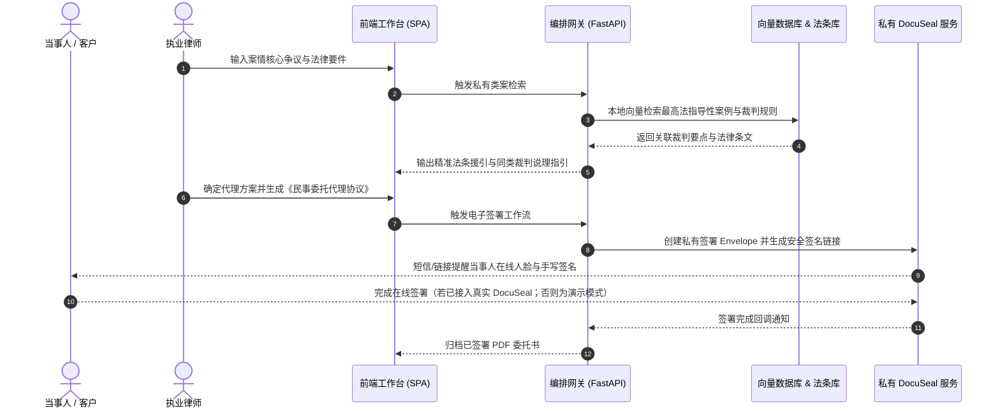

# LawFlow 智律工作台 —— 四层解耦系统架构设计

> 面向中国执业律师的本地私有化办案提效中枢系统。基于本地大模型 `gemma4:12b` 与中国司法实务规则构建，实现从客户咨询、立案计算、起诉文书生成、证据链梳理质证到类案检索与电子签约的全流程闭环。

---

## 一、系统整体四层架构图

---

## 二、端口映射与服务注册表

系统严格遵循全局端口隔离规范与私有化通信原则：

| 服务名称 | 编排/Profile | 内部端口 | 宿主机映射端口 | 监听地址 | 用途说明 |
| :--- | :--- | :--- | :--- | :--- | :--- |
| **LawFlow Gateway & Web** | 默认必启 (base) | `8000` | **8000** (或本地5221) | `127.0.0.1` | FastAPI 统一网关中枢与前端 SPA 静态界面 |
| **Stirling-PDF** | 默认必启 (base) | `8080` | **8081** | `127.0.0.1` | 司法文书 PDF 转换、合并、印章与 OCR 中间件 |
| **Docassemble** | `phase1` | `80` | **8080** | `127.0.0.1` | 引导式民事起诉问卷采访服务 (挂载 fonts 目录) |
| **DocuSeal** | `phase3` | `3000` | **8082** | `127.0.0.1` | 私有化电子签名与委托合同流转加签平台 |
| **RAGFlow** | `phase3` (预留) | `9380` | `9380` | `127.0.0.1` | 外部 RAGFlow 容器网络接口 (`ragflow-net`) |
| **Host Ollama Server** | 宿主机系统服务 | `11434` | **11434** | `127.0.0.1` | 本地大模型服务 (`gemma4:12b`, `embeddinggemma`) |

> [!IMPORTANT]
> - 本地原生开发时网关可同时支持 `8000` 或 `5221` 端口启动，容器化编排严格按照 `8000 / 8081 / 8080 / 8082` 分阶段映射。
> - 所有对外暴露的 Web 服务一律显式绑定 `127.0.0.1`，坚决杜绝直接暴露公网导致律所办案数据外泄。

---

## 三、四大核心业务流转机制

### 1. 诉讼立案文书流水线 (Phase 1)

### 2. 证据链清洗与质证 Agent 流水线 (Phase 2)

### 3. 私有类案 RAG 检索与电子签约流水线 (Phase 3)

---

## 四、安全合规与私有化保障

1. **绝对离线与隐私保护 (Zero Cloud Leaks)**:
   - 所有办案文书、当事人身份证、财务流水仅在律所内网/本地 Docker 存储卷中处理，不调用任何公网商业大模型 API。
   - 大模型直接运行在本地宿主机 Ollama（`gemma4:12b`），推理完全本地化。
2. **司法排版绝对合规 (Judicial Typography Standards)**:
   - 严格遵循《党政机关公文格式》(GB/T 9704-2012) 与最高人民法院裁判文书排版习惯。
   - 标题：二号方正小标宋简体 / 黑体；
   - 正文：三号仿宋_GB2312，首行缩进 2 字符，固定行距 28-30 磅；
   - 容器内预置中文字体刷新机制，根绝 Linux Docker 容器生成 Word/PDF 乱码方块问题。
3. **法律算法零容差 (Mathematical Determinism)**:
   - 诉讼费、LPR利息、仲裁补偿金严格由纯 Python 确定性数学算法执行，杜绝大模型在涉及金额数字时的幻觉。
