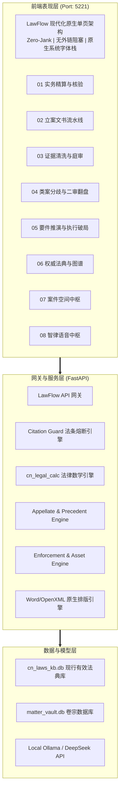

# LawFlow 智律工作台 (LawFlow Workspace)

> **面向一线诉讼律师与企业法务总监的实战级私有化法律科技中枢**  
> 告别“泛泛而谈的 AI 法律玩具”，将**请求权基础分析法、证据三性对抗逻辑、司法会计精算与执行穿透攻防体系**深度嵌入办案动线。

[](https://fastapi.tiangolo.com/)
[](https://www.python.org/)
[](LICENSE)
[]()
[-brightgreen.svg)]()

---

## 🌟 核心实务五大攻防大屏 (P0 - P4)

LawFlow 摒弃传统的“单轮对话生成几千字废话”模式，围绕红圈所合伙人一线承办的极端疑难案件，打造了五大攻防中枢：

### 1. P0 跨境英文合同霸王条款 Redline 与非破坏性修订
* **实务痛点**：大模型重写英文采购合同时原格式炸裂、条款空洞。
* **攻防利器**：
  * 基于双向最长公共子序列（LCS）的**非破坏性模糊锚定引擎**；
  * 内置跨国并购强/弱势甲乙方博弈 Playbook；
  * 原文档样式 100% 保留，直接导出带 **Word 原生批注与修订轨道**的 `.docx` 文件。

### 2. P1 卷宗物理视觉切片 (BBox Grounding) 与调解 NPV 动态精算
* **实务痛点**：开庭前夕临时收到 50 页新证据，法官主持当庭调解时无法快速验算方案真伪。
* **攻防利器**：
  * 原卷 PDF 坐标级切片提取，点击质证意见即可直接弹出**对应卷宗页码的高清视觉裁剪片段**；
  * 离散现金流 **NPV 动态贴现模型** 与以物抵债折价清偿精算，3 分钟算清调解案值，杜绝客户因时间价值产生隐性亏损。

### 3. P2 《民法典》第 561 条法定冲抵精算与第 692 条保证期间生死线
* **实务痛点**：民间借贷与企业借款中债务人主张“已偿还款项应先抵扣本金”，以及多主体交叉网状担保主张责任免除。
* **攻防利器**：
  * 严格遵循《民法典》第 561 条法定清偿顺序（**实现债权费用 ➔ 利息 ➔ 本金**），一键出具带法言法语的穿行对账单；
  * 自动化测算《民法典》第 692 条法定 6 个月保证期间除斥线，拦截保证责任法定灭失重大执业风险；
  * 穿透新《公司法》第 15 条对外担保法定决议效力。

### 4. P3 二审/再审生死局·一审裁决漏洞剖析与最高院类案分歧穿透
* **实务痛点**：一审 8000 万对赌回购案件惨遭地方中院裁判滑铁卢，距上诉截止日仅剩 5 天。
* **攻防利器**：
  * **三大致命败诉破绽探针**：股权回购错定民间借贷套 4 倍 LPR、宏观行业调控滥用《民法典》第 533 条情势变更、违约金畸重调减剥夺机会成本；
  * **最高法院及权威高院类案裁判分歧对抗矩阵**（最高法公报判例 vs 一审错误样本）；
  * 一键生成符合《最高人民法院关于统一法律适用加强类案检索的指导意见（试行）》（法发〔2020〕24号）规范的《类案检索法律论证意见书》与《民事上诉状（事实与理由靶向重构版）》。

### 5. P4 1.2 亿元执行终本破局·财产线索穿透与追加被执行人作战大屏
* **实务痛点**：执行局裁定终结本次执行程序（终本），被执行人空壳账面仅剩 342.18 元，实控人金蝉脱壳转移财产。
* **攻防利器**：
  * **出资未届期转让穿透探针**：依据新《公司法》第 47/88 条及追加规定第 17-19 条，击穿 0 元转让股权找五保老人背债阴谋，追加原股东张某某在未出资 4950 万元范围内承担补充清偿责任；
  * **一人公司人格混同探针**：依据《公司法》第 23 条第三款及追加规定第 20 条，归集公转私混同流水，触发**法定举证责任倒置**，追加实控人对 1.2 亿元全部债务承担连带责任；
  * **假离婚撤销探针**：比对时序倒错，依据《民法典》第 538 条行使**债权人撤销权**，追回 4500 万元两套豪宅恢复拍卖；
  * **倒签租赁破壁探针**：穿透发票开票日、租金流向与实际管领权，粉碎案外人虚假异议，提起执行异议之诉；
  * 一键生成《追加被执行人申请书》与《执行异议之诉起诉状》并原生导出 Word。

---

## 🛡️ 司法“零幻觉”底座：Citation Guard

* **废止法规硬熔断**：严禁引用已废止的《合同法》《物权法》《担保法》《民法通则》，自动重写衔接《民法典》现行条款；
* **本地 SQLite FTS5 权威法典穿透**：条号真实性、内容一致性硬核校验；
* **司法裁判案号防伪核验**：严格校验各级人民法院裁判文书案号编订标准，彻底杜绝大模型捏造案号与法条。

---

## 🏗️ 系统架构



---

## 🚀 快速启动

### 1. 环境准备
```bash
git clone https://github.com/kevinyaowenrui-hue/lawflow.git
cd lawflow

# 安装依赖
pip install -r requirements.txt # 或 pip install fastapi uvicorn python-docx pydantic jinja2
```

### 2. 启动开发服务器
```bash
# 启动统一网关 (默认绑定 127.0.0.1:5221)
python -m uvicorn gateway.main:app --host 127.0.0.1 --port 5221 --reload
```
打开浏览器访问：`http://127.0.0.1:5221`

### 3. 运行全量实证自动化测试套件
```bash
python -m pytest test_top5_refactor.py test_p0_english_redline.py test_p1_visual_and_settlement.py tests/test_p2_guarantee_and_cashflow.py tests/test_p3_appeal_and_precedent.py tests/test_p4_enforcement_and_asset_penetration.py --disable-warnings -v
```
> 全部 28 项核心实证测试用例 100% 通过。

---

## 📄 开源许可证

本项目基于 [MIT License](LICENSE) 开源。
